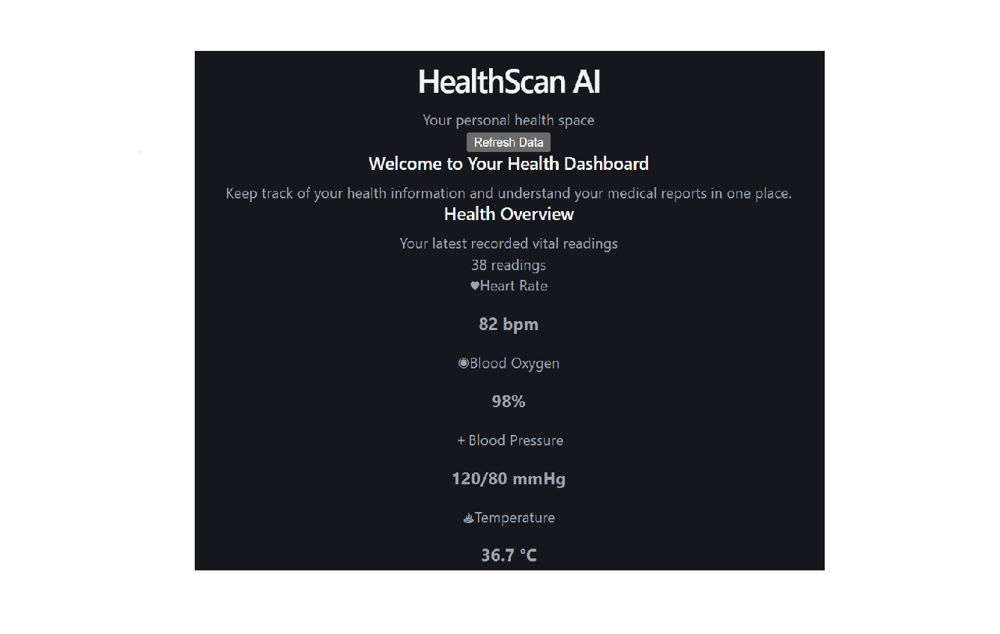

# HealthScan AI

### Understand medical reports. Track vital readings. See the trends.

A full-stack health information dashboard that extracts supported vital measurements from PDF reports, generates a separate AI-assisted explanation, and visualizes saved readings over time.

  <a href="https://health-scan-ai-henna.vercel.app/"><strong>Live Website</strong></a>
  ·
  <a href="https://healthscan-ai-xabx.onrender.com/api/health"><strong>Backend Health</strong></a>
  ·
  <a href="https://github.com/swathyjayakumar222-art/HealthScan-AI"><strong>Source Code</strong></a>

---

## Overview

HealthScan AI is a health-information management project built to make medical-report text easier to work with. Users can upload a text-based PDF, view the text extracted from it, identify supported vital measurements, and request a separate plain-language explanation from Google Gemini. Readings can also be entered manually or saved from the extraction results so users can review their history and trends on a dashboard.

**The project addresses three practical problems:**

- **Manual report reading:** locating useful information in a lengthy medical PDF can take time.
- **Hard-to-interpret values:** a list of measurements alone does not explain the report's written findings in plain language.
- **Scattered tracking:** readings from different dates are difficult to compare without a consistent history and visualization.

HealthScan AI brings these workflows into one application. It is an informational tool—not a diagnostic or treatment system.

## Interface screenshots

The repository includes screenshots of the dashboard, vital-trend charts, manual data entry, and medical-report workflow.

  
   
  <em>Health dashboard overview</em>

  
   
  <em>Heart rate, SpO₂, blood pressure, and temperature trends</em>

  
   
  <em>Medical report upload and recent readings</em>

  
   
  <em>Manual vital measurement entry</em>

> Note: these are interface screenshots stored in the repository; the live UI may evolve independently as the project is updated.

## Key features

### 1. PDF report text extraction
- Accepts PDF uploads through the Flask API.
- Uses **PyPDF** to read selectable text from report pages.
- Shows the extracted source text separately so users can refer back to the document.
- Reports when no selectable text is found; scanned image PDFs require OCR, which is not currently built into the extraction pipeline.

### 2. Structured vital extraction
- Uses Python regular expressions to look for supported values in extracted report text.
- Supports heart rate, oxygen saturation (SpO₂), blood pressure, and body temperature.
- Displays detected values as structured measurement cards rather than raw JSON.
- Marks values that were not found instead of inventing measurements.
- Lets users save supported extracted measurements to their vital history.

### 3. AI-assisted report explanation
- Uses the **Google Gemini API** to generate an explanation distinct from the structured extraction results.
- Organizes the explanation into a report summary, important values, supported reference-range observations, a plain-language explanation, and questions to discuss with a clinician.
- Tries configured fallback Flash models when the primary model reports temporary capacity errors.
- Shows progress and actionable messages for common configuration or provider errors.

### 4. Vital tracking and visualizations
- Supports manual entry of heart rate, SpO₂, systolic/diastolic blood pressure, and temperature.
- Stores readings in MySQL.
- Visualizes saved numeric readings over time.
- When no readings exist, the dashboard can show a clearly labelled illustrative chart preview. **Preview values are not real health measurements and are not saved.**

### 5. User and report records
- Includes backend signup and login endpoints with password hashing.
- Stores report text and generated analysis where database persistence succeeds.
- Provides diagnostic endpoints for API and database connectivity.

## How it works

~~~mermaid
flowchart TD
    U[User uploads a PDF] --> P[Flask API + PyPDF]
    P --> T[Extract selectable PDF text]
    T --> V[Regex-based vital extraction]
    T --> G[Google Gemini report explanation]
    V --> R[Structured measurement cards]
    G --> A[Plain-language AI explanation]
    R --> S[User reviews and optionally saves readings]
    S --> D[(MySQL database)]
    D --> C[Dashboard and trend charts]
~~~

Vital extraction and AI explanation are **separate operations**: extraction finds supported values in the text; Gemini explains the report's content in context. The AI explanation may be incomplete or inaccurate and should be reviewed with a qualified healthcare professional.

## Tech stack

| Layer | Technology | Role |
|---|---|---|
| Frontend | React 19, Vite | Interactive dashboard and report workflow |
| Styling | CSS | Responsive layout, forms, cards, and chart presentation |
| Backend | Python, Flask | REST API and report processing |
| PDF processing | PyPDF | Extracts selectable text from PDF pages |
| Measurement extraction | Python regular expressions | Finds supported vital values in report text |
| AI | Google Gemini API, <code>google-genai</code> | Generates a report explanation |
| Database | MySQL | Stores vital readings, users, and report records |
| Database hosting | Aiven | Managed MySQL service in the deployed setup |
| Frontend hosting | Vercel | Hosts the web interface |
| Backend hosting | Render + Gunicorn | Hosts the Flask API |

## Repository structure

~~~text
HealthScan-AI/
├── backend/
│   ├── app.py                 # Flask routes, PDF processing, Gemini, MySQL
│   ├── requirements.txt       # Python dependencies
│   └── gunicorn.conf.py       # Production request timeout settings
├── frontend/
│   ├── src/
│   │   ├── App.jsx            # Dashboard and report workflow
│   │   ├── App.css            # Application components and layout
│   │   └── index.css          # Global design tokens and typography
│   ├── screenschots/          # Existing project interface screenshots
│   ├── package.json
│   └── vite.config.js
├── package.json
└── README.md
~~~

## Run locally

### Prerequisites
- Python 3.10+
- Node.js and npm
- A MySQL database (local MySQL or a reachable managed MySQL instance)
- A Google Gemini API key for AI report explanation

### 1. Clone the repository

~~~bash
git clone https://github.com/swathyjayakumar222-art/HealthScan-AI.git
cd HealthScan-AI
~~~

### 2. Configure and run the backend

~~~powershell
cd backend
python -m venv .venv
.\.venv\Scripts\Activate.ps1
pip install -r requirements.txt
~~~

Create a private <code>.env</code> file inside <code>backend/</code> with your own values:

~~~dotenv
# Gemini
GEMINI_API_KEY=replace_with_your_gemini_api_key
GEMINI_MODEL=gemini-3.8-flash
# Optional comma-separated fallback models for temporary overloads
GEMINI_FALLBACK_MODELS=gemini-3.6-flash,gemini-3.5-flash-lite

# MySQL (example local configuration)
MYSQL_HOST=127.0.0.1
MYSQL_PORT=3306
MYSQL_USER=root
MYSQL_PASSWORD=replace_with_your_mysql_password
MYSQL_DATABASE=healthscan

# Optional: path to the provider's CA certificate when SSL verification is configured
# MYSQL_SSL_CA=/path/to/ca.pem
~~~

Make sure the MySQL account can create tables if the database is empty. The backend has schema-initialization code for the required <code>users</code>, <code>vitals</code>, and <code>reports</code> tables.

Start Flask:

~~~powershell
python app.py
~~~

The local backend runs at <code>http://127.0.0.1:5000</code>.

### 3. Configure and run the frontend

Open a second terminal at the repository root:

~~~powershell
cd frontend
npm install
~~~

Create <code>frontend/.env</code>:

~~~dotenv
VITE_API_BASE_URL=http://127.0.0.1:5000
~~~

Start Vite:

~~~powershell
npm run dev
~~~

Open the local URL printed by Vite, typically <code>http://localhost:5173</code>.

> In production, the frontend defaults to the deployed Render API URL. Use <code>VITE_API_BASE_URL</code> to override it for another environment. The value should be the API base host, without an additional <code>/api</code> suffix.

## Environment variables

| Variable | Required? | Purpose |
|---|---|---|
| <code>GEMINI_API_KEY</code> | For AI analysis | Secret key for the Gemini API |
| <code>GEMINI_MODEL</code> | Optional | Primary model; the code has a default |
| <code>GEMINI_FALLBACK_MODELS</code> | Optional | Comma-separated models tried on temporary capacity errors |
| <code>MYSQL_HOST</code> | For MySQL | Database hostname |
| <code>MYSQL_PORT</code> | For MySQL | Database port |
| <code>MYSQL_USER</code> | For MySQL | Database username |
| <code>MYSQL_PASSWORD</code> | For MySQL | Database password |
| <code>MYSQL_DATABASE</code> | For MySQL | Database name |
| <code>MYSQL_SSL_CA</code> | Optional | CA certificate path for verified TLS connections |
| <code>VITE_API_BASE_URL</code> | Optional | Frontend backend base URL |

For Render, add backend secrets in **Render → service → Environment**. Never put server secrets in frontend environment variables or commit real credentials to GitHub.

## API endpoints

| Method | Endpoint | Purpose |
|---|---|---|
| GET | <code>/</code> | Basic backend status |
| GET | <code>/api/health</code> | API health check |
| GET | <code>/api/db-test</code> | Test MySQL connectivity |
| POST | <code>/api/signup</code> | Create a user account |
| POST | <code>/api/login</code> | Verify user login |
| GET | <code>/api/vitals</code> | Read saved vital measurements |
| POST | <code>/api/vitals</code> | Save a vital measurement record |
| GET | <code>/api/reports</code> | Retrieve stored report records |
| POST | <code>/api/upload-report</code> | Upload PDF and extract selectable text |
| POST | <code>/api/extract-vitals</code> | Extract supported vital values from text |
| POST | <code>/api/analyze-report</code> | Generate an AI-assisted explanation |
| PUT | <code>/api/reports/{report_id}/analysis</code> | Save or update a report explanation |

## Deployment

- **Frontend:** [health-scan-ai-henna.vercel.app](https://health-scan-ai-henna.vercel.app/)
- **Backend:** [healthscan-ai-xabx.onrender.com](https://healthscan-ai-xabx.onrender.com/)
- **API health:** [GET /api/health](https://healthscan-ai-xabx.onrender.com/api/health)

The deployed backend also requires a working MySQL connection and <code>GEMINI_API_KEY</code> to generate AI explanations. If Gemini's primary model is temporarily unavailable, the backend attempts the configured fallback models.

## Limitations and future work

- OCR for scanned image-only PDFs.
- More robust measurement parsing for varied report layouts and units.
- Automated backend/frontend tests and API contract tests.
- Stronger user/session authorization before storing real user health records.
- Better historical-report management and downloadable summaries.

## Security and medical disclaimer

- Keep <code>.env</code> files, database passwords, Gemini keys, and real patient PDFs out of Git.
- Do not commit personally identifiable or sensitive medical information.
- Validate uploaded files and protect report data before using the application with real users.
- HealthScan AI is for informational purposes only. AI-generated content may be inaccurate or incomplete and is not a diagnosis or treatment recommendation. Consult a qualified healthcare professional for medical decisions.

---

Built as a full-stack minor project exploring PDF processing, health-data visualization, REST APIs, and AI-assisted report explanation.

