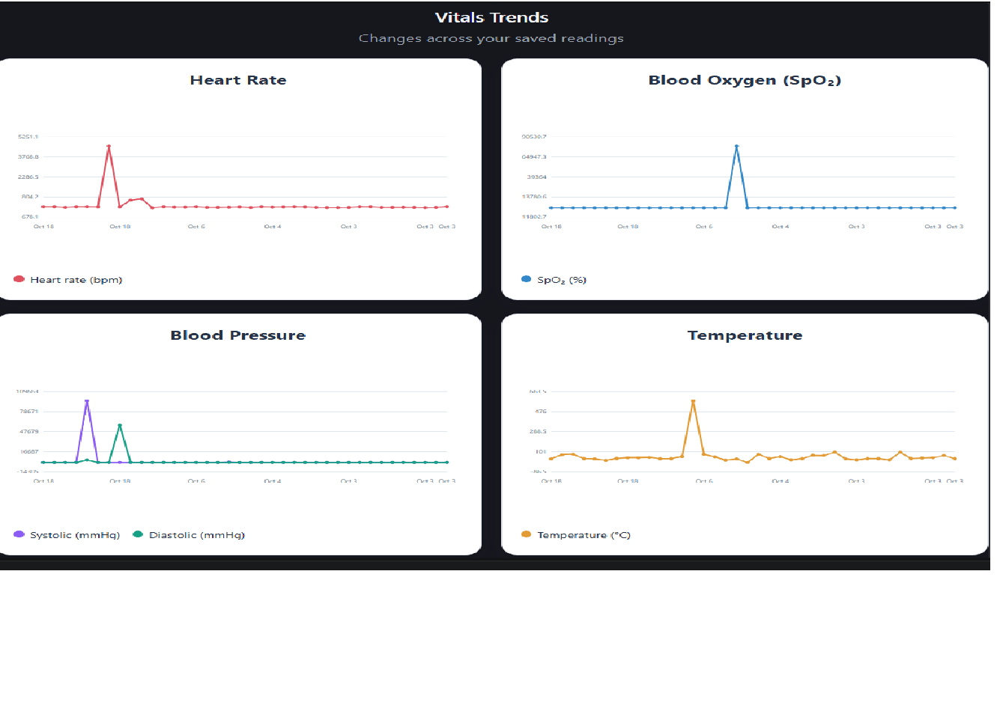
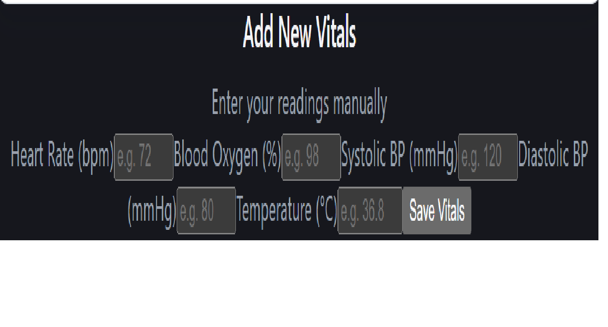
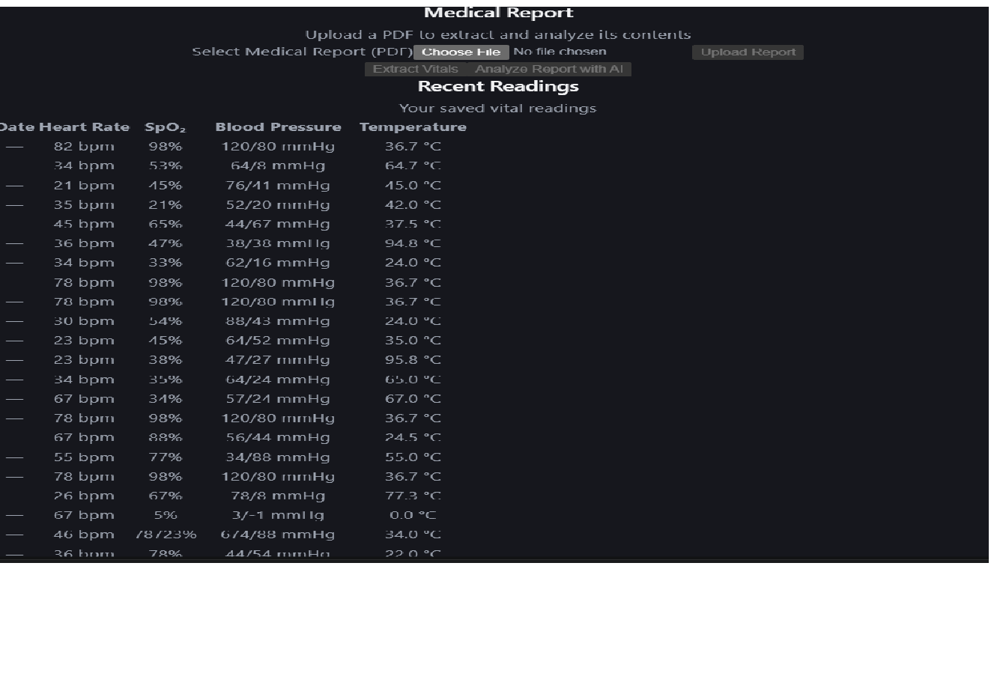
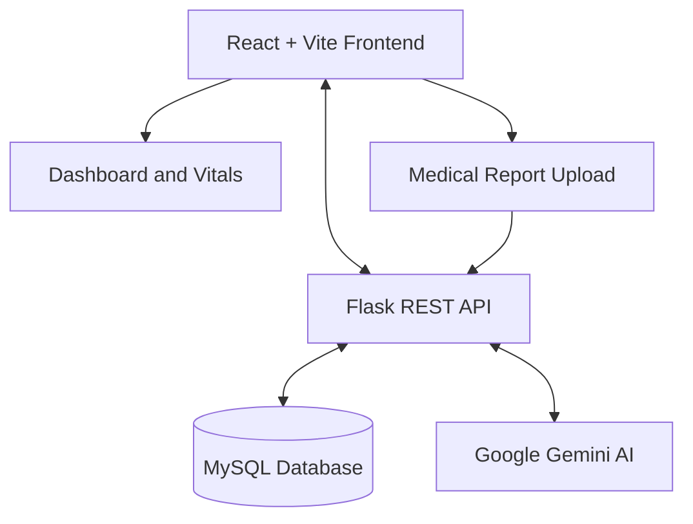

# 🩺 HealthScan AI — Intelligent Health Monitoring & Report Analysis

HealthScan AI is a full-stack healthcare application that helps users track health vitals, visualize health trends, upload medical reports, and receive AI-assisted explanations of report contents using Google Gemini.

The application combines a React frontend, Flask REST API, MySQL database, and AI-powered report analysis in one platform.

## ✨ Features

- **User Authentication** — User signup and login.
- **Health Dashboard** — View health information from one place.
- **Vitals Tracking** — Record heart rate, SpO₂, blood pressure, and body temperature.
- **Health Trends** — Visualize recorded vital measurements using charts.
- **Medical Report Upload** — Upload PDF medical reports.
- **PDF Text Extraction** — Extract selectable text from uploaded reports.
- **Vitals Extraction** — Identify supported vital measurements in report text.
- **AI Report Analysis** — Generate plain-language explanations of medical report contents using Gemini.
- **Database Integration** — Store user information, vitals, and report information in MySQL.

## 🖥️ Screenshots

### Health Dashboard


### Vitals Trends


### Add Vitals


### Medical Report


## 🏗️ System Architecture



## 🛠️ Tech Stack

| Component | Technology |
|---|---|
| Frontend | React, Vite, CSS |
| Backend | Python, Flask |
| API Communication | REST API, JSON |
| Database | MySQL |
| AI Integration | Google Gemini API |
| PDF Processing | PyPDF |
| Authentication | Flask endpoints, password hashing |
| Charts | Recharts |

## 📁 Project Structure

```text
HealthScan-AI/
├── backend/
│   ├── app.py
│   ├── requirements.txt
│   ├── .env
│   └── uploads/
├── frontend/
│   ├── src/
│   │   ├── App.jsx
│   │   └── App.css
│   ├── screenshots/
│   │   ├── dashboard.png
│   │   ├── vitals-trends.png
│   │   ├── add-vitals.png
│   │   └── medical-report.png
│   └── package.json
├── .gitignore
└── README.md
```

*Note: This structure illustrates the main files and folders. Your actual project may contain additional files.*

## ⚙️ Prerequisites

Install the following before running the application:

- Python 3.10 or later
- Node.js and npm
- MySQL Server
- A Google Gemini API key

## 🚀 Installation and Setup

### 1. Clone the Repository

```bash
git clone YOUR_GITHUB_REPOSITORY_URL
cd HealthScan-AI
```

Replace `YOUR_GITHUB_REPOSITORY_URL` with your actual GitHub repository URL.

### 2. Set Up the Backend

Open a terminal in the project root:

```bash
cd backend
python -m venv venv
```

Activate the virtual environment.

**Windows PowerShell:**

```powershell
.\venv\Scripts\Activate.ps1
```

Install the Python dependencies:

```bash
pip install -r requirements.txt
```

### 3. Configure Environment Variables

Create a `.env` file inside the `backend` folder:

```env
GEMINI_API_KEY=your_gemini_api_key
GEMINI_MODEL=your_supported_gemini_model
MYSQL_PASSWORD=your_mysql_password
```

Replace the placeholder values with your own configuration. Use a Gemini model supported by your API key.

**Never upload your actual `.env` file or API key to GitHub.**

### 4. Configure MySQL

Start MySQL Server and create the database:

```sql
CREATE DATABASE healthscan;
```

Ensure the required tables (`users`, `vitals`, and `reports`) exist with the columns expected by `backend/app.py`. Configure your MySQL username and password in the backend settings.

### 5. Start the Backend

From the `backend` folder, activate the virtual environment if needed and run:

```bash
python app.py
```

The Flask backend runs at:

```text
http://127.0.0.1:5000
```

### 6. Start the Frontend

Open a second terminal from the project root:

```bash
cd frontend
npm install
npm run dev
```

Open the local URL printed by Vite, usually:

```text
http://localhost:5173
```

Keep both terminals running while using the application.

## 🔌 Main API Endpoints

| Method | Endpoint | Purpose |
|---|---|---|
| GET | `/api/health` | Check API health |
| POST | `/api/signup` | Register a user |
| POST | `/api/login` | Log in a user |
| GET | `/api/vitals` | Retrieve saved vitals |
| POST | `/api/vitals` | Save vital measurements |
| GET | `/api/reports` | Retrieve report records |
| POST | `/api/upload-report` | Upload and process a PDF |
| POST | `/api/extract-vitals` | Extract vitals from report text |
| POST | `/api/analyze-report` | Generate an AI-assisted report explanation |

## 🔐 Security and Privacy

- Store API keys and database credentials in environment variables.
- Exclude `.env`, virtual environments, `node_modules`, and private uploads from version control.
- Do not commit real patient reports or personally identifiable medical information.
- Use appropriate authentication, access controls, and secure deployment settings before exposing the application publicly.
- The development Flask server is intended for local development, not production deployment.

## ⚠️ Medical Disclaimer

HealthScan AI provides health tracking and AI-assisted explanations for informational purposes only. AI-generated content may be incomplete or inaccurate and must not be treated as a diagnosis, treatment recommendation, or substitute for advice from a qualified healthcare professional. Always consult a healthcare professional for medical decisions.

## 🔮 Future Enhancements

- OCR support for scanned PDF reports.
- More comprehensive health trend analysis.
- Improved input validation and automated tests.
- Production deployment with secure authentication.
- Downloadable health summaries and reports.

## 👩‍💻 Author

Developed as a full-stack healthcare technology project using React, Flask, MySQL, and Google Gemini AI.

---

**If you find this project useful, consider giving the repository a ⭐ on GitHub.**
